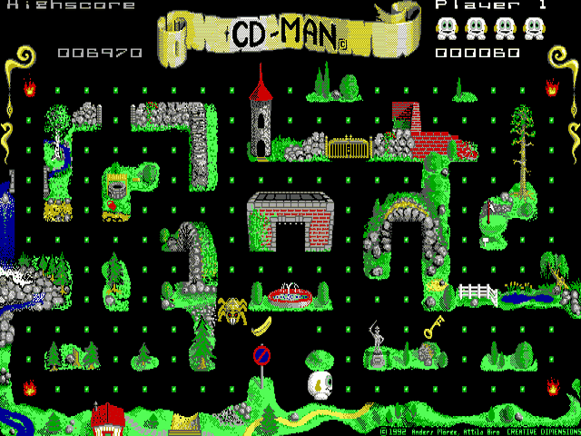
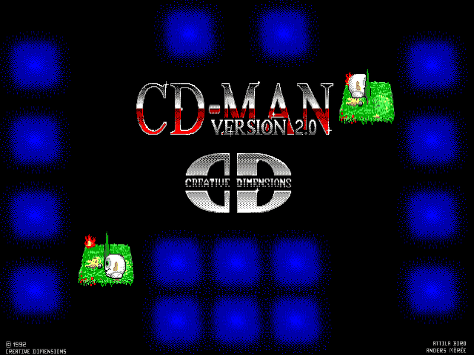
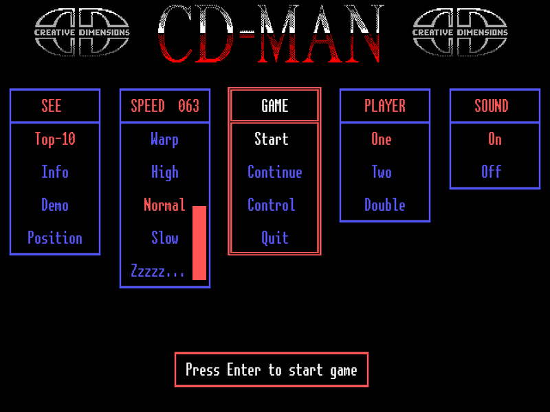
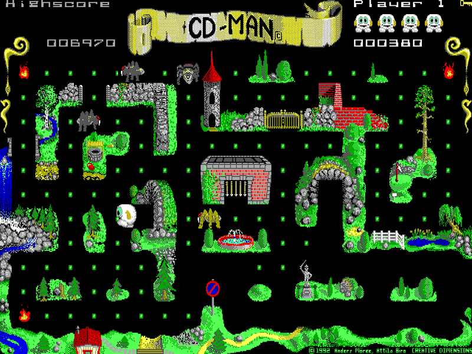
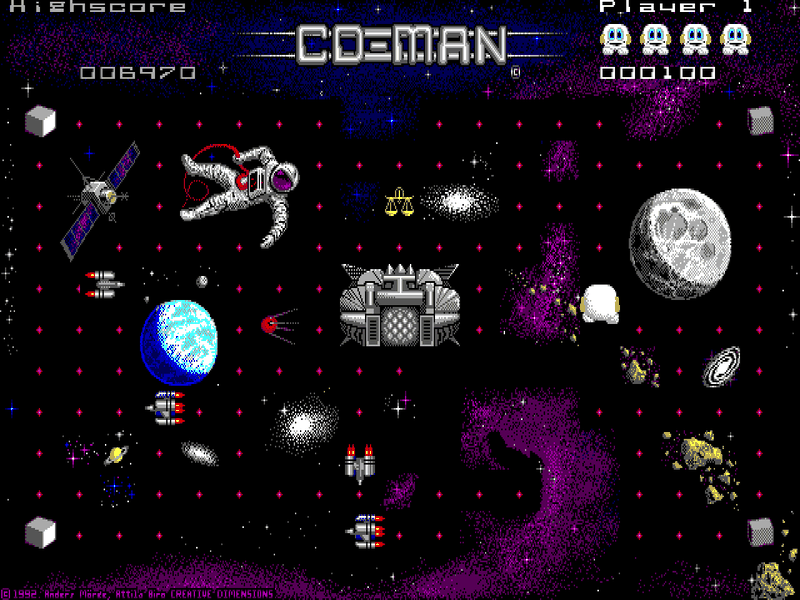
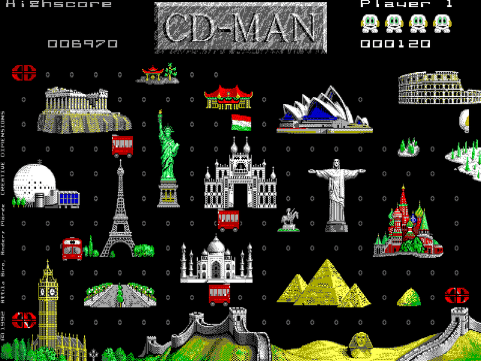
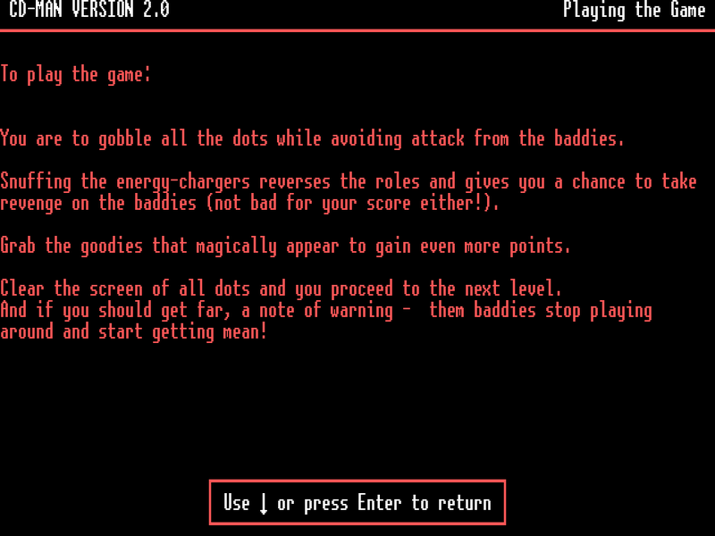
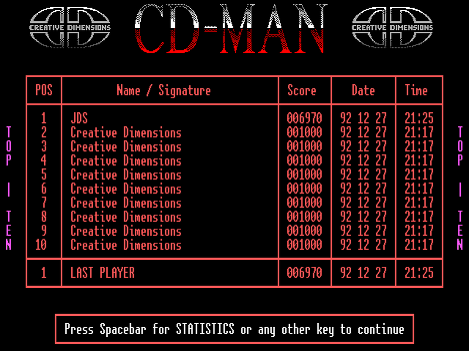
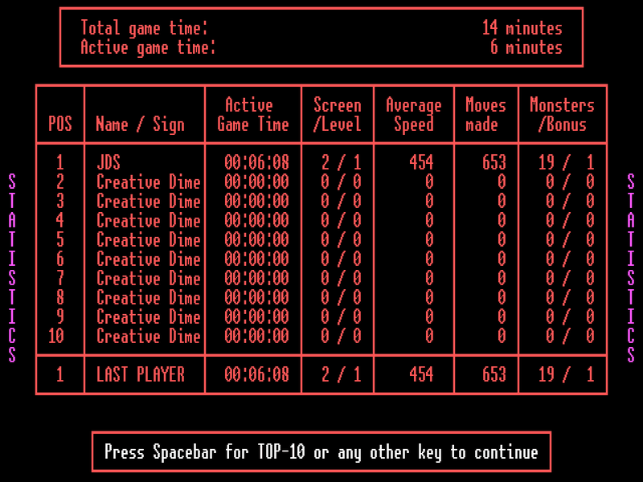

# CD-MAN

[English](README.md) | **Русский**

Порт игры CD-MAN 2.0 (Creative Dimensions, 1992) — вариации на тему
«Пакмана» для EGA. CD-Man собирает точки в пяти лабиринтах-картинах:
парк у замка, тропические острова, космос, достопримечательности мира и
ночное озеро. Его преследуют четыре монстра, энергозаряды в углах на время
делают их съедобными, а в лабиринте появляются бонусы.

Работает на Linux, macOS и Windows.



| | |
|---|---|
|  |  |
|  |  |
|  |  |
|  |  |

## Сборка и запуск

Нужен Go 1.25 или новее.

```sh
go build -o cdman .   # cdman.exe на Windows
./cdman
```

`make dist` собирает версии для Linux, macOS и Windows (amd64 и arm64) в
каталог `dist/`. Сборка возможна на любой из этих систем для любой другой.

На Linux нужны OpenGL (Mesa) и ALSA (`libasound`). В настольных
дистрибутивах они обычно уже установлены.

## Файлы игры

Порту нужны файлы оригинальной игры CD-MAN 2.0: программа `CDMAN2.EXE`
(из неё берутся лабиринты, тексты и таблицы) и картинки `*.CDM`. В
комплект они не входят. Игра ищет их:

- рядом с программой и в её подкаталоге `Source`;
- в текущем каталоге и в его подкаталоге `Source`;
- в каталоге настроек игры (см. ниже).

Регистр букв в именах не важен. Если файлы не найдены, игра откроет окно с
подсказкой: тогда перетащите папку с игрой (или сами файлы) прямо в это
окно, и игра скопирует их в каталог настроек. Каталог можно указать и
явно: `./cdman -data путь/к/игре`.

`HELP.CDM` и `HIGHSC.CDM` необязательны: без первого не будет справки,
второй хранит таблицы рекордов и статистики. `XMUSE.BIN` из дистрибутива
игре не нужен.

## Управление

| Клавиша | Действие |
|---|---|
| Стрелки, цифровой блок 8/4/6/2 | движение; в меню — выбор |
| Первая буква пункта меню | выбрать пункт |
| Enter | выполнить пункт меню |
| Esc | меню во время игры (Continue — продолжить) |
| Ctrl+Q | немедленный выход, как в оригинале — без сохранения рекордов |
| F5 / F6 | меньше / больше задержка картинки под звук |
| F7 / F8 / F9 | медленнее / быстрее / обычная скорость эталонной машины |
| F11 или Alt+Enter | полноэкранный режим |

В режиме Double первый игрок управляет клавишами W (вверх), A (влево),
D (вправо), X или Z (вниз), второй — стрелками.

Геймпад работает как клавиатура: крестовина и левый стик — стрелки, нижняя
кнопка и Start — Enter, правая кнопка и Back — Esc. Пункт меню «Control» →
«Joystick» относится к игровому порту PC: его в порте нет, поэтому игра,
как и оригинал без джойстика, сообщит, что джойстик не найден.

Если звук отстаёт от картинки (так бывает с Bluetooth-наушниками и
колонками), подберите задержку клавишами F5/F6: шаг — 20 мс, значение видно
в заголовке окна и запоминается.

## Меню

Меню работает в текстовом режиме, как в оригинале.

- **SEE**: Top-10 — таблица десяти лучших (пробел — статистика), Info —
  справка, Demo — демонстрация, Position — посмотреть на прерванную игру.
- **SPEED**: скорость игры от Zzzzz… до Warp; стрелки вверх и вниз меняют
  её плавно, число показывает текущее значение (63 — Normal).
- **GAME**: Start — новая игра, Continue — продолжить прерванную, Control —
  клавиатура или джойстик, Quit — выход с сохранением таблицы рекордов.
- **PLAYER**: One — один игрок, Two — двое по очереди, Double — двое
  одновременно.
- **SOUND**: звук PC-спикера включён или выключен.

Закрытие окна равносильно пункту Quit: время игры учитывается, таблица
рекордов сохраняется.

## Правила

CD-Man съедает точки; когда их не остаётся, этап пройден. Монстры выходят
из клетки посередине лабиринта и преследуют CD-Man; чем дальше, тем
охотнее они идут прямо к нему. Энергозаряд в углу (в парке — огонь) на
время делает монстров съедобными: они меняют облик и убегают, а съеденный
монстр (100, 200, 300 и 400 очков подряд) возвращается в клетку. Время от
времени в лабиринте появляется фрукт, за который дают очки случайной
величины. На некоторых экранах есть тоннели. В парке у замка есть ключ:
с ним CD-Man открывает ворота, а второй ключ даёт очки.

Игра проходит пять экранов по два раза, затем третий круг — по разу.
На последнем экране третьего круга точки не исчезают, а энергозаряды
возвращаются: этот этап длится, пока у игрока есть жизни. Тот, кто побил
лучший результат таблицы (и набрал не меньше 10 000 очков), увидит
особую заставку.

Таблица рекордов и статистика (время игры, этап, средняя скорость, число
ходов, съеденные монстры и бонусы) хранятся в `HIGHSC.CDM` в том же виде,
что и у оригинала, так что файл можно переносить между портом и
DOS-версией.

## Параметры командной строки

| Флаг | Назначение |
|---|---|
| `-data путь` | каталог с файлами игры |
| `-speed 1.0` | скорость эталонной машины (больше — быстрее) |
| `-fullscreen` | запуск в полноэкранном режиме |
| `-volume 0.7` | громкость 0…1 |
| `-audio-delay мс` | задержка картинки под звук (по умолчанию — сохранённая) |

Отладочные флаги описаны в [docs/ORIGINAL.md](docs/ORIGINAL.md).

## Каталог настроек

Таблица рекордов (`HIGHSC.CDM`), настройки (`settings.txt`) и перетащенные
в окно файлы игры хранятся в каталоге настроек:

- Linux: `~/.config/cdman/`
- macOS: `~/Library/Application Support/cdman/`
- Windows: `%AppData%\cdman\`

При первом запуске таблица рекордов читается из каталога игры, а
сохраняется уже в каталог настроек.

## Отличия от оригинала

- Нет защиты от копирования: оригинал при первом запуске просил назвать
  огонь по руководству.
- Закрытие окна сохраняет таблицу рекордов (в оригинале — только Quit).
- Джойстика на игровом порту нет (см. «Управление»).

Остальное повторяет оригинал вплоть до его ошибок. Порт сверялся с
оригиналом, исполняемым в эмуляторе: при одинаковых нажатиях состояние
игры совпадает байт в байт на каждом тике. Подробности — в
[docs/ORIGINAL.md](docs/ORIGINAL.md).

## Авторы

Авторы игры — Anders Morée и Attila Biró, Creative Dimensions, 1992.

## Лицензия

Исходный код распространяется по лицензии MIT, текст — в файле
[LICENSE](LICENSE).

Файлы оригинальной игры в проект не входят. Права на программу, графику и
тексты CD-MAN принадлежат её авторам (© 1992 Creative Dimensions), лицензия
MIT на них не распространяется. Шрифты текстового режима основаны на
[unscii-16](http://viznut.fi/unscii/), который находится в общественном
достоянии.
